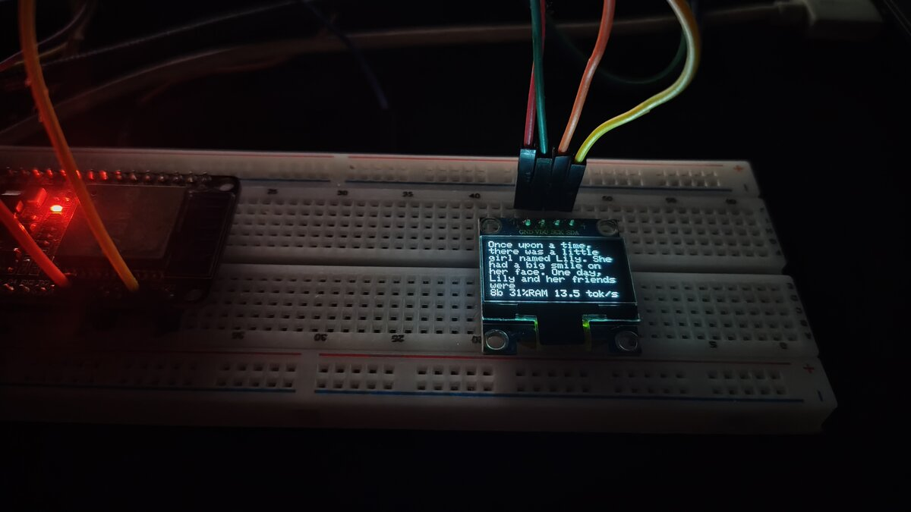

# Tiny LLM on an ESP32 + OLED

A 260K-parameter Llama 2 model ([`stories260K`](https://github.com/karpathy/llama2.c), trained on TinyStories) writing children's stories on a plain ESP32 with **no PSRAM**, shown word by word on a 128×64 SSD1306 OLED.

The model continues a story opening ("Once upon a time…"). It does not chat or follow instructions.



## Versions

Each version is a complete Arduino sketch in its own directory. Speeds measured on an ESP32-D0WD-V3 (240 MHz, 4 MB flash, no PSRAM), 64-token stories.

| Directory | What changed | Flash contents at `0x290000` | Speed |
|-----------|--------------|------------------------------|-------|
| [`v0-baseline/`](v0-baseline) | Upstream flash-streaming port, serial output only, model read from LittleFS | `model/littlefs.bin` | 2.3 tok/s (upstream figure) |
| [`v1-oled/`](v1-oled) | Story scrolls on the OLED with live tok/s, new story every 5 s | `model/littlefs.bin` | 2.1 tok/s |
| [`v2-mmap/`](v2-mmap) | Model mapped into memory from a raw flash region (`esp_partition_mmap`) instead of ~4,000 `fseek`/`fread` calls per token through LittleFS | `model/stories260K.bin`, plus `model/tok512.bin` at `0x3A0000` | 10.1 tok/s |
| [`v3-q8/`](v3-q8) | Weights quantized to int8 with one float scale per row (`tools/quantize.py`), read straight from flash | `model/stories260K_q8.bin`, plus `model/tok512.bin` at `0x3A0000` | **15.3 tok/s** |
| [`v4-lowbit/`](v4-lowbit) | One sketch for 8, 6, 4, 2 and 1-bit weights (`tools/quantize_bits.py`), copying as many weight blocks into RAM as fit. Benchmarks itself at boot | `model/stories260K_bN.bin`, plus `model/tok512.bin` at `0x3A0000` | 11.2–13.3 tok/s, see below |

All versions use the default 4 MB partition table, so the data partition starts at `0x290000`.

## How low can the bits go? (v4)

Weights in groups of 32, one float scale per group, each scale chosen to minimize error. Perplexity is measured on the laptop on 8 stories written by the float model (lower is better). Speeds are on the board, greedy, 64 tokens, average of 3 runs.

| Bits | Model size | Perplexity | Story | Weights in RAM | tok/s, flash | tok/s, RAM |
|------|-----------|------------|-------|----------------|--------------|------------|
| float32 | 1,057 KB | 2.63 | reference | – | 10.1 (v2) | – |
| 8 | 302 KB | 2.63 | same as float | 31% | 12.7 | 13.3 |
| 6 | 235 KB | 2.63 | same opening, different details | 40% | 11.2 | 11.7 |
| 4 | 169 KB | 2.82 | coherent, different story | 56% | 12.0 | 12.6 |
| 2 | 103 KB | 43.8 | "Once upon upon upon upon…" | 91% | 12.2 | 13.1 |
| 1 | 69 KB | 1551 | ends immediately | 100% | 11.2 | 11.8 |

For every bit width the board's greedy story matches the laptop's word for word, so the unpacking on the board is correct.

What this shows:

- **Quality holds down to 6 bits, dips slightly at 4, and collapses at 2 and 1.**
- **Fewer bits do not make it faster on this chip.** Even with the 1-bit model entirely in RAM, speed stays around 12 tok/s. After v2 and v3 the bottleneck is the processor, not reading weights: unpacking codes costs about as much as the smaller reads save, and 6-bit (4 codes in 3 bytes) is the slowest to unpack.
- **v3's plain int8 kernel (15.3 tok/s) is still the fastest.** v4's group scales and generic unpacking cost about 20% at 8 bits.
- Only ~231 KB of heap is free at startup (largest block 110 KB), and the KV cache takes 82 KB of it, so no model above 2 bits fits entirely in RAM.

## Hardware

| OLED | ESP32 |
|------|-------|
| SDA  | GPIO 23 |
| SCL  | GPIO 21 |
| VCC / GND | 3V3 / GND |

## Running a version

```sh
# 1. Write the model for that version (see the table). For v3-q8:
esptool --port /dev/ttyUSB0 write-flash 0x290000 model/stories260K_q8.bin 0x3A0000 model/tok512.bin
#    for v0/v1:  write-flash 0x290000 model/littlefs.bin
#    for v2:     write-flash 0x290000 model/stories260K.bin 0x3A0000 model/tok512.bin
#    for v4:     write-flash 0x290000 model/stories260K_b4.bin 0x3A0000 model/tok512.bin   (or _b8, _b6, _b2, _b1)

# 2. Build and upload the sketch
arduino-cli compile --fqbn esp32:esp32:esp32 -u -p /dev/ttyUSB0 v3-q8
```

Type a story opening in the serial monitor (115200 baud) to use it for the next story.
From v2 on, if the flash holds the wrong data the screen shows "Model not in flash" instead of crashing.

`model/stories260K_q8.bin` is generated from the float model (needs numpy); `--check` compares float vs int8 greedy stories:

```sh
python3 tools/quantize.py model/stories260K.bin model/stories260K_q8.bin --check model/tok512.bin

# v4: one file per bit width, and the quality table above
python3 tools/quantize_bits.py model/stories260K.bin 4 model/stories260K_b4.bin
python3 tools/quantize_bits.py model/stories260K.bin --compare model/tok512.bin
```

## Checking the int8 model

With `-DTEMPERATURE=0.0f -DSTORY_START=""` the board always picks the most likely token, and its story matches the int8 story printed by `quantize.py --check` word for word. The float and int8 models agree on the first 61 of 64 tokens; while they agree, the logits differ by at most 0.3 (typical range 29.5).

## Ideas

See [IDEAS.md](IDEAS.md) for what is done and what is next.

## Credits

- Model, tokenizer and the original inference code: [karpathy/llama2.c](https://github.com/karpathy/llama2.c) (MIT).
- ESP32 flash-streaming port in `v0-baseline/` (originally `Tiny_Llamas`): [Circuit-Digest/ESP32-Tiny-LLM](https://github.com/Circuit-Digest/ESP32-Tiny-LLM) (marked MIT in its README).
